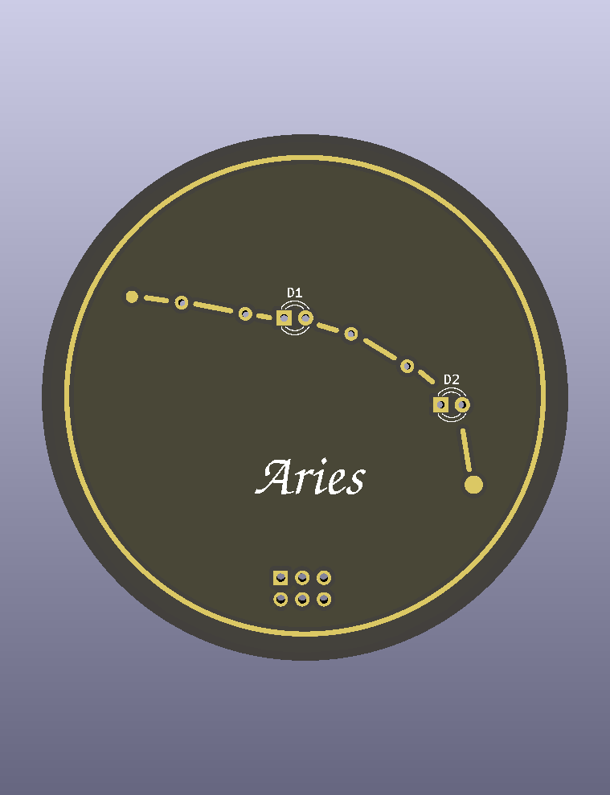
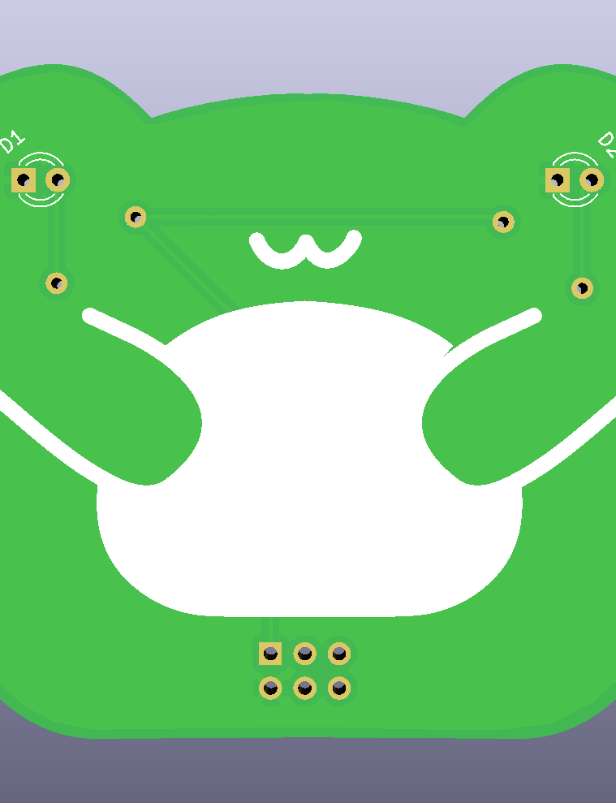
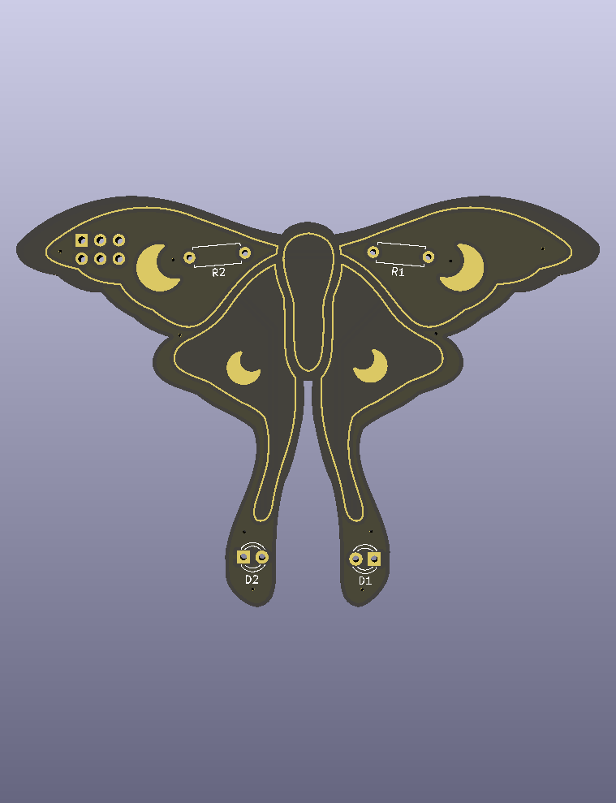

# Whimsical PCBs


**KiCad-Workshop für kreative und kunstvolle PCBs**

PCBs müssen nicht rechteckig, grün oder langweilig sein. Sie können auch Frösche, Motten, kleine Feuergeister oder Sternbilder werden. In diesem Workshop gestalten wir ein eigenes **Shitty (oder Simple) Add-On (SAO)**: ein kleines PCB, das über einen Stecker an einen kompatiblen Badge angeschlossen werden kann.

Vier Motive, dieselbe einfache Schaltung und jede Menge Möglichkeiten, etwas Eigenes daraus zu machen.

## Was du hier lernen kannst

- KiCad-Projekte öffnen und dich im Schaltplan- und PCB-Editor zurechtfinden
- Einen einfachen Schaltplan zeichnen, Bauteile verbinden und Footprints zuordnen
- Mit **ERC** (Electrical Rules Check) den Schaltplan prüfen
- Bauteile auf der PCB platzieren und Leiterbahnen **routen**
- PCB-Layer verstehen und verwenden: Kupfer, Solder Mask, Silkscreen und `Edge.Cuts`
- **Vias**, **Filled Zones** und **Keepout-/Rule-Areas** ausprobieren
- Eigene Formen und Artwork einfügen, z. B. aus SVG-Dateien
- Mit **DRC** (Design Rules Check) das PCB prüfen und im **3D-Viewer** ansehen

## Die vier Projekte

Alle vier Projekte benutzen die gleiche Grundschaltung: **zwei LEDs, zwei Widerstände und einen SAO-Header**. Die Form und die Gestaltung unterscheiden sich.

| Vorschau | Projekt |
| --- | --- |
|  | **[Zodiac](zodiac/)** · Einstieg<br>Ein rundes PCB für dein Sternzeichen oder ein selbst erfundenes Sternbild. Zwei LEDs sind die hellsten Sterne, weitere Sterne und Linien entstehen mit Kupfer-Artwork.<br>**Techniken:** Silkscreen, Kupfer-Artwork, freigelegtes Kupfer (z. B. mit ENIG-Oberfläche). |
|  | **[Frog](frog/)** · Einstieg<br>Ein kleiner Frosch mit zwei LEDs als Augen.<br>**Techniken:** Eigene `Edge.Cuts`, Silkscreen-Artwork. |
|  | **[Luna Moth](luna_moth/)** · Fortgeschritten<br>Eine Lunamotte mit LEDs an den langen Hinterflügeln.<br>**Techniken:** Eigene `Edge.Cuts`, Kupfer-Artwork und freigelegtes Kupfer. |
|  | **[Calcifer](calcifer/)** · Fortgeschritten<br>Ein kleiner Feuergeist mit von hinten durchleuchteten Bereichen.<br>**Techniken:** Eigene `Edge.Cuts`, Silkscreen, Rule Areas und Licht durch das PCB. |

Die Schwierigkeitsgrade sind nur eine Orientierung. Such dir einfach das Motiv aus, auf das du Lust hast!

## Was du brauchst

- Einen Laptop mit **Git**
- eine Maus, am besten mit Mausrad
- **KiCad 10**
- Dieses Repository

### KiCad installieren

Die Projekte wurden mit **KiCad 10** erstellt. Achte darauf, dass du nicht versehentlich eine ältere Version installierst. Die offiziellen Downloads und distributionsspezifischen Anleitungen findest du unter [kicad.org/download](https://www.kicad.org/download/).

**Arch Linux:**

```bash
sudo pacman -Syu kicad kicad-library kicad-library-3d
```

**Ubuntu** (KiCad-10-PPA, statt der häufig älteren Version aus den Standard-Repositories):

```bash
sudo add-apt-repository ppa:kicad/kicad-10.0-releases
sudo apt update
sudo apt install kicad
```

**Debian:**

```bash
sudo apt update
sudo apt install kicad
```

Achtung: Je nach Debian-Version bekommst du damit möglicherweise **nicht KiCad 10**. In dem Fall nutze die Flatpak-Version weiter unten.

**Fedora:**

```bash
sudo dnf install kicad kicad-packages3d
```

**openSUSE Tumbleweed:**

```bash
sudo zypper install kicad
```

**Flatpak** (Alternative für Linux, wenn die Distribution kein KiCad 10 anbietet):

```bash
flatpak install --from https://flathub.org/repo/appstream/org.kicad.KiCad.flatpakref
```

**Windows oder macOS:** Nutze die offiziellen Installer für [Windows](https://www.kicad.org/download/windows/) bzw. [macOS](https://www.kicad.org/download/macos/). Viel Glück.

### Repository klonen

```bash
git clone https://github.com/bitshiftcrazy/whimsical_pcbs.git
cd whimsical_pcbs
```

Wähle eines der vier Projektverzeichnisse und öffne die jeweilige `.kicad_pro`-Datei, zum Beispiel `frog/frog.kicad_pro`.

## Wie funktioniert der Workshop?

Wir arbeiten gemeinsam vom **Schaltplan** zum **fertigen PCB-Layout**:

1. Schaltplan vervollständigen und ERC ausführen.
2. Footprints auf dem PCB platzieren.
3. Routing, Vias und Kupferzonen ausprobieren.
4. Dein PCB mit Silkscreen, Kupfer und eigenen Formen gestalten.
5. DRC ausführen und das Ergebnis im 3D-Viewer anschauen.

Du musst nicht exakt das Beispiel nachbauen. Experimentieren ist ausdrücklich erwünscht!

### Was liegt wo?

Jeder Projektordner enthält:

- **`<projekt>.kicad_pro`, `.kicad_sch`, `.kicad_pcb`:** Dein Ausgangspunkt für den Workshop. Schaltplan und Layout sind absichtlich noch nicht fertig.
- **`solution/`:** Fertiger Schaltplan und fertig geroutetes PCB als Beispiel und Rettungsanker, falls etwas schiefgeht. Die Vorlagen wurden mit ERC und DRC geprüft.
- **`<projekt>.png`:** Vorschau aus KiCads 3D-Viewer.
- **`*.svg`** (wo vorhanden): Ausgangsformen, mit denen du den Import von PCB-Umrissen üben kannst.
- **`<projekt>.pretty/`** und **`fp-lib-table`** (wo vorhanden): Lokale Footprints für dekoratives Artwork. Zodiac kommt ohne eigene Footprint-Bibliothek aus.

**Tipp:** Du kannst jederzeit die fertigen Dateien in `solution/` anschauen. Die Dateien in deinem Hauptprojekt bleiben davon unberührt.

Viel Spaß beim Basteln, Hardware darf auch einfach nur schön, albern oder völlig unnötig sein.
